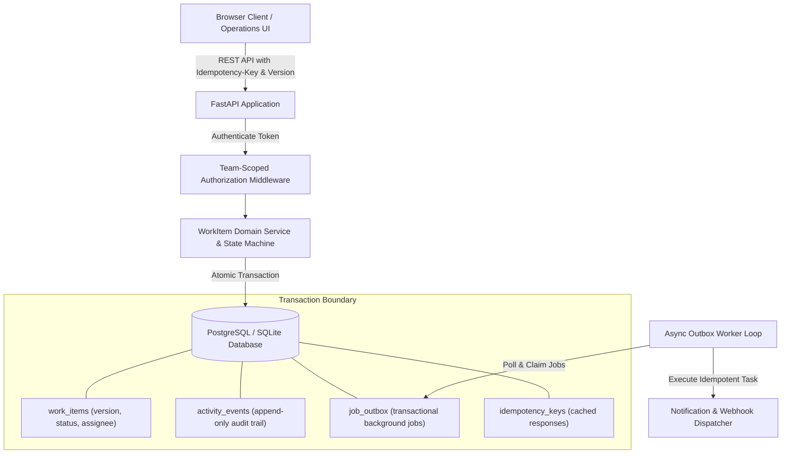

# Newtonite — Operations Under Pressure Platform

An internal operations web application built to create, assign, track, and resolve high-stakes operational work items across teams with strict concurrency control, transactional audit logging, and team-scoped authorization.

---

## Architecture Diagram



---

## Prerequisites
- **Option A (Docker - Recommended):** Docker and Docker Compose
- **Option B (Local Python):** Python 3.11+ (tested on Python 3.13)

---

## One-Command Run Setup

### Using Docker Compose (Recommended)
```bash
# Clone the repository
git clone https://github.com/tanishak04/newtonite-ops-2300971530130.git
cd newtonite-ops-2300971530130

# Start Postgres, FastAPI app, and transactional Outbox Worker
docker compose up --build
```
The application will be live at: **http://localhost:8000**

To inspect background outbox worker logs in real time:
```bash
docker compose logs -f worker
```

---

### Running Locally (Without Docker)
```bash
# 1. Create and activate virtual environment
python -m venv .venv
# On Windows:
.\.venv\Scripts\activate
# On Linux/macOS:
# source .venv/bin/activate

# 2. Install dependencies
pip install -r requirements.txt

# 3. Run database migrations & seed demo dataset
alembic upgrade head
python -m app.scripts.seed

# 4. Start the application
uvicorn app.main:app --host 0.0.0.0 --port 8000 --reload
```
Open **http://localhost:8000** in your browser.

To run the background outbox worker in a separate terminal:
```bash
python -m app.worker
```

---

## Database Migrations (Alembic)

The project uses **Alembic** configured for asynchronous SQLAlchemy. Migrations apply identically across PostgreSQL (`asyncpg`) and local SQLite (`aiosqlite`).

- Apply latest migrations: `alembic upgrade head`
- Check current revision: `alembic current`
- Verify model-to-migration consistency: `alembic check`

---

## Demo Credentials Table

| User Email | Default Password | Team | Role | Capabilities |
| :--- | :--- | :--- | :--- | :--- |
| **alice@newtonite.io** | `LeadPass123!` | Core Platform | **LEAD** | Full CRUD, Claim, Approve, Close |
| **bob@newtonite.io** | `MemberPass123!` | Core Platform | **MEMBER** | Create, Claim, Update, Request Approval |
| **charlie@newtonite.io**| `ViewerPass123!` | Core Platform | **VIEWER** | Read-only item & timeline access |
| **diana@newtonite.io**  | `AdminPass123!`  | Core Platform | **ADMIN**  | Full administrative management |
| **evan@newtonite.io**   | `LeadPass123!` | Payments & Billing | **LEAD** | Lead in Payments (Forbidden in Core) |
| **fiona@newtonite.io**  | `MemberPass123!` | Payments & Billing | **MEMBER** | Member in Payments |
| **george@newtonite.io** | `LeadPass123!` | Compliance & Risk | **LEAD** | Lead in Compliance |

> **Pro Tip:** In the web UI, use the top-right **"Switch User"** dropdown to switch between Alice, Bob, Charlie, and Evan with one click.

---

## How to Run Automated Tests

The test suite runs with **100% test isolation**. A session fixture in `tests/conftest.py` automatically provisions an ephemeral disposable test database, runs migrations and test seeds, and cleans up on teardown. The developer database is never touched or modified.

```bash
pytest -v
```

### Critical Behaviours Tested (27/27 Passing):
1. `tests/test_concurrency.py`: Parallel atomic claim race conditions (`200` vs `409 Conflict`) and stale update rejection with optimistic locking (`409 Conflict`).
2. `tests/test_idempotency.py`: Replayed `Idempotency-Key` network retries returning cached responses without duplicate rows, payload mismatch rejection (`400 Bad Request`), concurrent duplicate request race recovery on commit collisions, and cross-user key theft prevention (`403 Forbidden`).
3. `tests/test_edge_cases.py`: Cross-team data access isolation (`403 Forbidden`), Viewer write denial on create, claim, update, and comment (`403 Forbidden`), terminal status lifecycle protection (`CLOSED` immunity against transitions, claims, and edits), cross-team activity log isolation, and cross-team assignee validation (`400 Bad Request`).
4. `tests/test_outbox_and_pagination.py`: Server-side composite cursor pagination across 1,000+ items with deterministic tie-breaking `(created_at, id)`, bounded exponential retry backoff, attempt caps with terminal failure, duplicate processing idempotency across worker restarts, multi-worker safe claiming with compare-and-swap, and abandoned worker crash recovery.
5. `tests/test_work_items.py`: Workflow state machine with Lead approval constraints (`AWAITING_APPROVAL -> RESOLVED`), dedicated activity timeline endpoint, and item deletion authorization.
6. `tests/test_auth.py`: Token authentication, invalid credentials rejection, and team role memberships.

---

## Known Limitations
- **Real-time Push:** Client updates currently use server-side filtered refetch/polling rather than WebSockets or SSE.
- **Outbox Side-Effect Boundary:** The transactional outbox guarantees durable at-least-once processing, bounded retries, and database deduplication. External notification dispatch (email/webhook) is simulated via structured logging; exactly-once delivery end-to-end requires downstream providers to support idempotency tokens.
- **SSO / Enterprise Auth:** SSO/SAML integration is omitted in favor of lightweight JWT token auth with seeded team roles.

---

## What I Would Build Next Week
1. **WebSocket / SSE Stream:** Replace HTTP polling with real-time Server-Sent Events push for collaborative board updates.
2. **Lead Reassignment Workflow:** Add explicit manager reassignment endpoints with justification comments and audit trails.
3. **Distributed Message Queue:** Transition outbox polling to Debezium Change Data Capture (CDC) streaming into RabbitMQ/BullMQ.
4. **File Attachments:** Add presigned S3/GCS URLs for incident diagnostic logs and screenshot uploads.
5. **SSO / Enterprise Auth:** Implement Google Workspace and Okta SAML 2.0 single sign-on.

See [ENGINEERING_DECISIONS.md](ENGINEERING_DECISIONS.md) for full context on architecture, design trade-offs, and scaling strategy.
