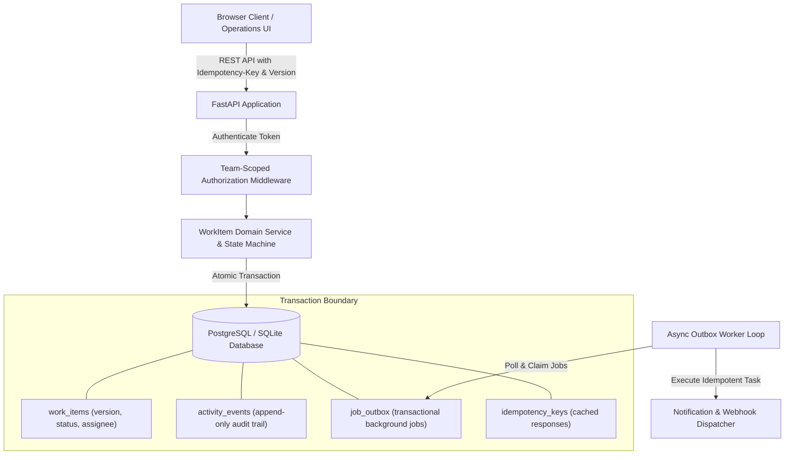

# Newtonite — Operations Under Pressure Platform

An internal operations web application built to create, assign, track, and resolve high-stakes operational work items across teams with strict concurrency control, transactional audit logging, and team-scoped authorization.

---

## Architecture Diagram



---

## Prerequisites
- **Option A (Docker - Recommended):** Docker and Docker Compose
- **Option B (Local Python):** Python 3.11+ (tested on Python 3.13)

---

## One-Command Run Setup

### Using Docker Compose (Recommended)
```bash
# Clone the repository
git clone https://github.com/tanishak04/newtonite-operations.git
cd newtonite-operations

# Start Postgres & FastAPI with automatic seeding
docker compose up --build
```
The application will be live at: **http://localhost:8000**

---

### Running Locally (Without Docker)
```bash
# 1. Create and activate virtual environment
python -m venv .venv
# On Windows:
.\.venv\Scripts\activate
# On Linux/macOS:
# source .venv/bin/activate

# 2. Install dependencies
pip install -r requirements.txt

# 3. Seed database (creates 4 teams, 10 users, 1500 items, audit events)
python -m app.scripts.seed

# 4. Start the application
uvicorn app.main:app --host 0.0.0.0 --port 8000 --reload
```
Open **http://localhost:8000** in your browser.

To run the background outbox worker in a separate terminal:
```bash
python -m app.worker
```

---

## Demo Credentials Table

| User Email | Default Password | Team | Role | Capabilities |
| :--- | :--- | :--- | :--- | :--- |
| **alice@newtonite.io** | `LeadPass123!` | Core Platform | **LEAD** | Full CRUD, Claim, Approve, Close |
| **bob@newtonite.io** | `MemberPass123!` | Core Platform | **MEMBER** | Create, Claim, Update, Request Approval |
| **charlie@newtonite.io**| `ViewerPass123!` | Core Platform | **VIEWER** | Read-only item & timeline access |
| **diana@newtonite.io**  | `AdminPass123!`  | Core Platform | **ADMIN**  | Full administrative management |
| **evan@newtonite.io**   | `LeadPass123!` | Payments & Billing | **LEAD** | Lead in Payments (Forbidden in Core) |
| **fiona@newtonite.io**  | `MemberPass123!` | Payments & Billing | **MEMBER** | Member in Payments |
| **george@newtonite.io** | `LeadPass123!` | Compliance & Risk | **LEAD** | Lead in Compliance |

> **Pro Tip:** In the web UI, use the top-right **"Switch User"** dropdown to switch between Alice, Bob, Charlie, and Evan with one click.

---

## How to Run Automated Tests

To run the complete automated test suite covering race conditions, optimistic locking, idempotency, edge cases, and RBAC:

```bash
pytest -v
```

### Critical Behaviours Tested:
1. `tests/test_concurrency.py`: Parallel atomic claim race condition (`200` vs `409 Conflict`) and stale update rejection with optimistic locking.
2. `tests/test_idempotency.py`: Replayed `Idempotency-Key` network retries returning cached response without duplicate row creation, and strict single-transaction audit history integrity.
3. `tests/test_edge_cases.py`: Cross-team data access isolation (`403 Forbidden`), Viewer write denial, and terminal status lifecycle protection (`CLOSED`).
4. `tests/test_outbox_and_pagination.py`: Server-side cursor pagination across 1,500+ items and reliable transactional outbox retries with maximum attempt caps.
5. `tests/test_work_items.py`: Workflow state machine with Lead approval constraints.
6. `tests/test_auth.py`: Token authentication and team role memberships.

---

## Known Limitations
- Real-time client updates currently use refetch/polling rather than WebSockets.
- Email delivery in the background outbox worker is simulated through structured logging.
- SSO / SAML integration is omitted in favor of lightweight token auth.

See [ENGINEERING_DECISIONS.md](ENGINEERING_DECISIONS.md) for full context on architecture, design trade-offs, and scaling strategy.
